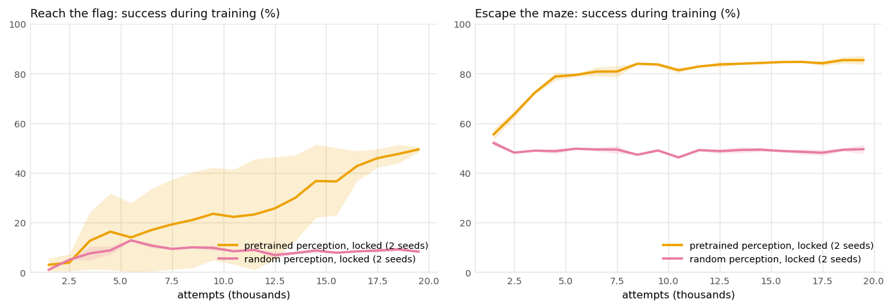
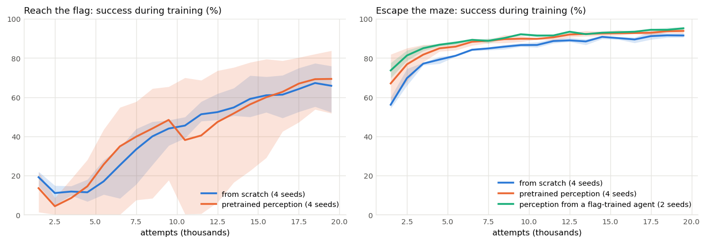

# Pretraining and transfer in the maze model

Can this maze model tell the story "pretrain once with no rewards, then use RL to make the model good
at a task, or at several tasks", the recipe behind LLM agents? This report maps what the model can and
can't show, with evidence, so the user can decide whether and how to use it. It doesn't design the
notebook.

**Setup for every run:** local desktop CPU (i5-13400F), 2 threads per run with 3–4 runs side by side;
the equal maze mix and the article's network size; 20,000 attempts per RL run, so every comparison is
at equal length. The learning rate anneals to zero over each run's own 20k attempts. Speeds are given
in attempts, not minutes, because runs shared the CPU.

## In short
1. **A network whose perception was pretrained with no rewards can learn a task with only its last
   layers trained. One with random perception can't.** With perception locked, pretrained perception
   reaches 97% on open mazes in the new escape task and 62–75% on open mazes in the flag task. Random
   perception stays at chance on both. This is the clearest evidence that pretraining put something
   useful into the network. **Strong; 2 seeds each, no overlap.**
2. **When the whole network keeps learning, pretraining gives a small, reliable head start on escape,
   a task it was never pretrained for:** 1.5–6.5 points higher training success averaged over the run
   than the from-scratch average. Every one of 8 pretrained runs beat every one of 4 from-scratch runs. It also escapes open mazes in about 24
   moves instead of about 31. Final success is the same. **Reliable but small.**
3. **On the flag task, pretraining doesn't reliably help at 20k attempts.** Half or more of the
   pretrained runs beat from-scratch, but about 1 in 4 stalls. The stalled runs keep leaving the maze,
   and the rule that drops attempts ending outside then starves them of training data. **Pretrained
   runs vary more than from-scratch runs.**
4. **Perception taken from an agent trained by RL on the flag task gives escape the best start of
   all,** better than reward-free pretraining. In this model, skills learned for one rewarded task
   transfer to a related task at least as well as reward-free pretraining does.

---

## The story, and how well the evidence supports each part

| Part of the story | What the maze shows | Support |
|---|---|---|
| Pretraining with no rewards teaches the network something real | Pretraining predicts unseen cells 86% of the time (53–55% by always guessing the most common kind of cell) and the direction to unexplored ground 99% (25% by chance), on mazes it never trained on. 3.2 min on 2 CPU threads; about 20 s on a T4 (earlier benchmark) | Strong |
| What it learned is useful for acting, not just for the quiz | With perception locked, RL on top of pretrained perception learns both tasks; on top of random perception it learns neither (Figure 1) | Strong |
| The same pretrained model can be turned into agents for different tasks by RL | One pretrained perception, two tasks: both learned. But a from-scratch network learns both too | Yes, but not unique to pretraining |
| Pretraining makes RL faster or better | Escape: small, reliable head start. Flag: no reliable gain, more spread between runs | Weak |
| Pretraining is general: it helps a task it was never built for | Escape (start at the flag, find any way out, no compass) gains reliably. But perception from a flag-trained RL agent helps escape *more* | Partial; see the caveat in "What the model can't show" |
| Rewards decide what the model is for | Same perception, different reward → an agent that reaches the flag, or one that leaves the maze as fast as it can | Holds, by construction |

---

## What was built

**The escape task**, as agreed in `HANDOFF.md`:
- The agent starts on the generated flag cell, in the lower right inside the maze.
- There's no flag on the map and no compass (the compass input is all zeros).
- Stepping onto any outside cell ends the attempt and earns the +5, with no outside penalty on that
  step. Wall and first-visit rewards are unchanged.
- No attempt is excluded from training: ending outside is the goal.

| Where | What |
|---|---|
| `mazerl/env.py` | `MazeEnv(task="escape")`; `compass_index` / `compass_from_index` |
| `mazerl/a2c.py` | `Settings.task`; `Settings.policy_init_scale` (an opt-in even starting policy, see experiment 4) |
| `mazerl/rollout.py` | `task=` on `record` and `evaluate`; `evaluate(None, …)` plays random moves; `standard_report` uses the run's task |
| `mazerl/perception.py` | stores "no compass" correctly (see the bug below) |
| `scripts/transfer.py` | one RL run: task, starting point (scratch, a pretraining file, or another run's perception), locked or not |
| `scripts/transfer_summary.py` | tables, curves (`--plot`), compact data (`--data`) |
| `tests/test_env.py` | 6 new tests: start position, no flag or compass, success on the first outside cell without the outside penalty, escape through a weak spot, compass storage, a short training run, even start |
| `reports/data/transfer-results.json` | every run: success per 1,000 attempts and the full test suite |

**A bug this exposed, now fixed.** The training buffer stored the compass as the index of its largest
entry. An all-zero compass would have been stored as "east" and replayed to the network that way
during learning, while it acted on zeros. Stored values now have a ninth "no compass" index. The flag
task is unaffected; its compass always has one entry set.

**All 33 tests pass** (`.venv/bin/python -m pytest -q tests`).

### How hard is escape? (checked before any experiment)
An agent moving at random, 300 new mazes of each kind, up to 200 moves:

| Maze kind | Reach the flag, random | Escape, random | Shortest way out from the flag cell |
|---|---|---|---|
| open | 1% | 52% | median 7 moves, no wall to break |
| route through a weak spot | 0% | 24% | median 11 moves; must break a wall (the flag's area is sealed inside) |
| route out and back in | 0% | 55% | median 8 moves, no wall to break |
| the p.6 maze, where the flag is walled off | — | 1% | must break a wall |

**Escape is much easier than reaching the flag.** The flag sits 1–5 cells from the outer wall, which
has 3–5 gaps plus weak spots, so a random walker gets out about half the time. That leaves less to
learn, and less room for pretraining to help. The weak-spot mazes are the hard part of escape.

---

## Experiments
Each prediction below was written into this file and committed before the runs it predicts (see the
git history). Seed *s* of a pretrained run uses pretraining run *s*.

**How results are measured:**
- **Average training success:** the share of training attempts that succeed, averaged over the whole
  20k-attempt run. One number per run for "how fast did it learn"; higher means it got good sooner.
- **Test:** 300 new mazes of each kind, after training.
- **Attempts to a threshold:** when training success (averaged over 5 log points) first passes a
  level, ignoring the first 1,000 attempts. Early on, only the quickest attempts have finished, and
  those are mostly successes, which inflates early success.

### 1. Does the same pretrained perception help a task it wasn't pretrained for?
Escape and flag, each from scratch and with pretrained perception that keeps learning; escape also with
pretrained perception locked. 2 seeds each, later extended to 4 (experiment 3).

**Predictions (written before running):**
- **Escape from scratch is quick.** At 20k: open and out-and-back mazes ≥ 95%, weak-spot mazes ≥ 75%,
  average moves to escape open mazes ≤ 15.
- **The transfer test.** Pretrained reaches 90% training success on escape in 20–40% fewer attempts
  than scratch, on both seeds. Final success within 3 points on open and out-and-back mazes; weak-spot
  mazes 5+ points higher with pretraining.
- **The relative help on escape is about the same as on the flag task** (within 15 points of the flag
  task's speed-up to 80%).
- **Locked works better on escape than on flag:** open and out-and-back mazes ≥ 90%, weak-spot mazes
  at least 10 points below the still-learning version.

**Results** (test success / average moves on new mazes):

| Escape, 20k attempts | Seed | Attempts to 90% | Open | Weak spot | Out and back | Avg training success |
|---|---|---|---|---|---|---|
| from scratch | 0 / 1 | 8.8k / 8.9k | 98% / 33 moves, 98% / 33 | 80%, 77% | 97%, 99% | 83.2%, 83.0% |
| pretrained | 0 / 1 | 7.3k / 4.8k | 99% / 26, 99% / 24 | 83%, 81% | 99%, 99% | 85.4%, 85.3% |
| pretrained, locked | 0 / 1 | 14.8k / 18.1k | 97% / 39, 97% / 41 | 64%, 62% | 96%, 96% | 79.7%, 78.0% |

| Flag, 20k attempts | Seed | Attempts to 50% / 80% | Open | Weak spot | Out and back | Avg training success |
|---|---|---|---|---|---|---|
| from scratch | 0 | 8.0k / 17.5k | 91% | 67% | 71% | 44.8% |
| from scratch | 1 | 8.1k / never | 86% | 72% | 1% | 37.1% |
| pretrained | 0 | 6.4k / 13.1k | 93% | 58% | 88% | 51.6% |
| pretrained | 1 | 12.3k / never | 88% | 44% | 58% | 25.9% |

**Against the predictions:**
- Escape from scratch: success ✓, but moves ✗. It takes about 31 moves to escape an open maze whose
  exit is about 7 moves away. Escape is easy to *achieve* and slow to do *well*.
- Transfer test: partly ✓. Pretrained reached 90% sooner on both seeds (17% and 46% fewer attempts),
  and escaped open mazes in fewer moves (24–26 vs 33). Weak-spot mazes were only 3–4 points higher,
  short of the predicted 5+.
- Escape vs flag: can't be judged from 2 seeds. On the flag task, one pretrained seed was faster and
  one much slower.
- Locked on escape: ✓. Open and out-and-back mazes 96–97%, weak-spot mazes 19 points below
  still-learning.

### 2. Is the locked result about pretraining, or would any fixed perception do?
If locked *random* perception does as well, the locked result says nothing about pretraining. Also:
does escape go better when perception comes from an agent RL-trained on the flag task?

**Predictions (written before running):**
- Escape, locked random perception: open and out-and-back mazes 85–95%; weak-spot mazes at least 10
  points below locked pretrained.
- Flag, locked pretrained vs locked random: locked pretrained open about 78% (an earlier one-seed
  run); locked random at least 15 points lower.
- Escape, starting from a flag-trained agent's perception (the from-scratch flag agents above, seeds 0
  and 1), still learning: reaches 90% sooner than reward-free pretraining (under 5k attempts), with
  weak-spot mazes ≥ 82%.

**Results:**

| Perception locked, 20k | Task | Open | Weak spot | Out and back | Avg training success |
|---|---|---|---|---|---|
| pretrained (2 seeds) | escape | 97%, 97% | 64%, 62% | 96%, 96% | 80%, 78% |
| random (2 seeds) | escape | 67%, 63% | 28%, 31% | 61%, 62% | 49%, 50% (chance is about 45%) |
| pretrained (2 seeds) | flag | 75%, 62% | 32%, 22% | 48%, 54% | 37%, 13% |
| random (2 seeds) | flag | 9%, 10% | 10%, 12% | 1%, 2% | 8%, 8% |



*Figure 1. Perception locked, only the last layers trained. Lines are the mean of 2 seeds; bands span
the seeds. With random perception, nothing is learned on either task: escape stays at the chance
level of a random walker, and flag success stays under 10%.*

| Escape, still learning, 20k | Seed | Attempts to 90% | Open | Weak spot | Avg training success |
|---|---|---|---|---|---|
| perception from a flag-trained agent | 0 / 1 | 3.6k / 4.9k | 99% / 25 moves, 100% / 24 | 84%, 84% | 89.7%, 88.2% |

**Against the predictions:**
- Locked random perception does far *worse* than I expected (✗ on its level, ✓ on the direction).
  It's no better than chance on escape and under 10% on flag. **Everything the locked agents learned
  depends on the pretrained perception.** Only the last 10k of 230k parameters are trained in both
  cases, so the difference is entirely what pretraining put into the locked part.
- Locked pretrained on flag: 62–75% open, matching the earlier run; random 9–10% ✓.
- Flag-trained perception on escape: ✓ for seed 0 (3.6k), and tied with the best pretrained seed for
  seed 1 (4.9k vs 4.8k). Weak-spot mazes 84% ✓. Its average training success (88–90%) is the
  highest of any escape start. This held even for seed 1, whose flag agent never learned to leave the
  maze and come back in.

### 3. With more seeds, is the escape gain real, and is the flag result really mixed?
**Predictions (written before running),** seeds 2 and 3, from scratch and pretrained, both tasks:
- Escape: pretrained above scratch on both new seeds, by 1–4 points of average training success, and
  higher test success on weak-spot mazes.
- Flag: no consistent direction. Across 4 seeds, the pretrained-minus-scratch difference changes
  sign at least once.

**Results** (average training success over 20k attempts, all 4 seeds):

| | Seed 0 | Seed 1 | Seed 2 | Seed 3 |
|---|---|---|---|---|
| Escape, from scratch | 83.2% | 83.0% | 83.4% | 83.7% |
| Escape, pretrained | 85.4% | 85.3% | **89.7%** | **88.2%** |
| Flag, from scratch | 44.8% | 37.1% | 36.2% | 42.1% |
| Flag, pretrained | 51.6% | 25.9% | **27.1%** | **56.6%** |



*Figure 2. Whole network learning. Lines are means over seeds; bands span the seeds. Escape: every
pretrained start sits above from-scratch for the first half of training, and the curves meet by the
end. Flag: pretrained runs spread far more widely than from-scratch runs.*

**Against the predictions:**
- Escape: ✓ on training success (+6.3 and +4.5 points, slightly above the predicted range); ✗ on
  weak-spot mazes (79% and 79% vs 81% and 81%). Across all four seeds, pretraining gives a reliably
  faster start, but no better end result.
- Flag: ✓. Two seeds better, two worse.
- Pretraining also changed *which* flag skills came first. Pretrained runs that learned did better on
  out-and-back mazes (84–88% vs 1–71%) and worse on weak-spot mazes (34–68% vs 59–72%).

### 4. Why do some pretrained flag runs stall?
**The finding that prompted this.** I looked at the move probabilities of each untrained agent at the
start of an attempt:
- **From scratch, the starting policy is even:** about 25% for each move.
- **With pretrained perception and fresh last layers, it's lopsided.** The favored move gets 49–97%,
  depending on the seed. The pretrained features are large, so the fresh layers' random weights
  produce a strong preference.

| Seed | Favored move at the start | Untrained attempts that end outside |
|---|---|---|
| 0 | right, into the maze (61%) | 41% |
| 1 | down (97%) | 28% (mostly stuck against walls) |
| 2 | up and left, out the entrance | **100%** |
| 3 | up (66%) | 76% |

On the flag task, attempts that end outside the maze are left out of training. Pretrained seed 2 went
**10,000 attempts without enough usable attempts for a single update.** The standard remedy is to
start the move-choice layer's weights near zero (×0.01), so every pretrained run starts with an even
policy.

**Predictions (written before running),** flag task, even start:
- Pretrained (seeds 0–3): no stalls (every seed above 5% training success over its first 5k
  attempts); average training success above from-scratch on at least 3 of 4 seeds, by 5–15 points;
  weak-spot mazes at least match from-scratch.
- From scratch (seeds 0–1): within ±6 points of from-scratch without it, since its start is already
  even.
- Pretrained, locked (seeds 0–1): open mazes ≥ 75% on both seeds.
- *Added before running:* escape, pretrained, even start (seeds 0–3): above from-scratch on at least
  3 of 4 seeds by 1–5 points; ≤ 28 moves to escape open mazes. Escape runs also start lopsided,
  usually favoring "down", which from the flag's corner tends to head toward the outer wall. That
  might have flattered pretraining on escape.

**Results** (average training success over 20k attempts):

| Even start | Seed 0 | Seed 1 | Seed 2 | Seed 3 | Compare with |
|---|---|---|---|---|---|
| Flag, pretrained | 47.7% | **11.3%** | 44.4% | 51.2% | scratch 44.8 / 37.1 / 36.2 / 42.1 |
| Flag, from scratch | 28.2% | 30.1% | — | — | scratch without it 44.8 / 37.1 |
| Flag, pretrained, locked | 16.6% | 17.7% | — | — | without it 36.7 / 12.5 |
| Escape, pretrained | 84.9% | 85.7% | 86.1% | 86.7% | scratch 83.2 / 83.0 / 83.4 / 83.7 |

**Against the predictions:**
- Flag, pretrained: 3 of 4 above scratch ✓, by 3–9 points (mostly ✓). But seed 1 stalled worse than
  before ✗. For its first 12k attempts, 52–71% of its attempts ended outside and were dropped, and it
  bumped walls about 47 times per attempt. **The even start removes the starting bias but not the
  stall.** The agent can drift into leaving the maze after the first updates. Attempts that end
  outside are dropped, so nothing in training pushes it back.
- Flag, from scratch: ✗. 28–30%, below the ±6-point band. One of the two runs never learned the
  out-and-back mazes (1%), the same all-or-nothing failure as a from-scratch run without the change.
  Whether that skill is picked up within 20k attempts looks like a coin flip. With 2 runs, the
  even-start change can't be separated from that.
- Flag, locked: ✗. 68–69% open, not better.
- Escape: ✓. All 4 seeds above scratch, by 1.5–3.5 points; 23–24 moves on open mazes. **The escape
  head start survives the even start**, about half its earlier size.

**What's established about the flag task:** across 8 pretrained runs (both starts) and 6 from-scratch
runs at 20k attempts:
- Pretrained averages: 11, 26, 27, 44, 48, 51, 52, 57%.
- From-scratch averages: 28, 30, 36, 37, 42, 45%.
- Pretraining raises the typical run a little and the best runs more. It also produces the worst runs.

Not established: *why* pretrained runs fall into leaving the maze more often. **A two-run test would
settle it:** pretrained seeds 1 and 2 on the flag task with attempts that end outside kept in training. If they
then learn normally, the stalls come from that rule starving them of training data.

---

## What the model can't show, or shows only weakly

- **"Pretraining makes RL much faster."** It doesn't here, when the whole network learns. The
  network is small and the mazes are simple, so RL from scratch learns the same perception itself
  within a few thousand attempts. The head start on escape is 1.5–6.5 points and gone by the end. In
  LLMs, pretraining supplies what RL could never find alone; here it supplies what RL finds anyway.
  **The maze can't demonstrate that necessity, except in the locked setting.**
- **A clean, single-run demonstration of the speed-up.** Seed-to-seed differences on the flag task
  (11–57% average training success) are several times the typical pretraining effect (about +7 points). A student running one
  pretrained and one from-scratch agent could see either order. Escape is steadier (from-scratch
  seeds within 1 point of each other), but its effect is 2–4 points, too small to see by eye on a
  noisy curve.
- **"Pretraining is general; task-specific training isn't."** In the maze, perception from an agent
  RL-trained on the flag task transferred to escape *better* than reward-free pretraining. The tasks
  share almost everything (same mazes, same walls, same weak spots). That fits "skills transfer
  between related tasks", not "reward-free pretraining is special."
- **Escape isn't fully new to the pretrained perception.** The pretraining quizzes were run on agents
  starting at the entrance, with a compass and the flag on the map. Escape changes the start, removes
  the compass and the flag, and changes the goal. The pretraining never saw a flag-free maze, so the
  transfer is real, but between near neighbors.
- **Escape is easy.** A random walker escapes about 45% of the time, so success curves start near
  60% and have little room to separate. The better measure of skill is moves to escape: about 31 from
  scratch, 24 with pretraining, against a shortest route of about 7.
- **Dropping attempts that end outside interacts with pretraining.** About 1 in 4 pretrained flag runs stalls while
  its attempts end outside and are dropped. That's a property of this setup, not of pretraining, and
  it would confuse a class that met it live.
- **Not measured here:** time on a T4 for these exact runs (the earlier benchmark gives 20k attempts
  ≈ 2.5 min, and locked runs about 1.6× faster per attempt), and anything past 20k attempts.

---

## Recommendations

**Worth putting in front of students:**
1. **The locked comparison (Figure 1)** is the strongest pretraining evidence this model has, and it's
   visual. Same network, same RL, only the last layers learn. On pretrained perception the agent
   learns to escape, and reaches the flag in most open mazes. On random perception it never does
   better than chance. The message: "the reward-free stage built the understanding; RL only taught
   it what to want."
   - It works on either task. Escape gives the cleaner contrast (97% vs 65% on open mazes, tight
     between seeds). Locked runs are also the fastest to train.
   - The shipped files would be: one pretrained perception, plus locked pretrained and locked random
     escape agents. Alternatively, students train the locked pair live: two 20k runs, the locked
     ones being cheaper.
   - Playback of the two locked agents on the same maze should make the difference obvious (not
     built or checked here).
2. **One pretrained model, two tasks.** Using one pretrained perception for both the flag and escape
   shows "rewards decide what the model is for." It holds by construction. Don't claim pretraining
   was needed for it; a from-scratch network also learns both.
3. **Pretraining's own quiz scores** (86% vs 54% for guessing, 99% vs 25% by chance) show what the
   reward-free stage learned, in a form students can read.

**Not worth putting in front of students:**
- **"Pretrained learns faster than from scratch," still learning, as a live comparison.** The effect
  is small next to run-to-run variation. On the flag task, a stalled pretrained run would teach the
  opposite. If it appears at all, use pre-run curves from several seeds, as in Figure 2.
- **"Reward-free pretraining transfers better than task training."** The maze shows the reverse.
- **A full escape lesson as a second RL task with its own reward tuning.** Escape is easy enough that
  a random walker half succeeds, so the success curve says little. If it's used, show moves to escape
  as well.

---

## Decisions for the user
1. **Keep pretraining in the activity, built around the locked comparison?** The comparison is
   strong. But it changes the lesson's wording from "pretraining speeds up RL" (not supported here) to
   "pretraining is what makes RL on a small top work" (supported).
2. **Which task carries the locked demo: escape (cleaner) or the flag (the article's task)?** If
   escape, the escape task needs player support: the player currently draws the flag and labels
   success "flag". `record()` marks escape episodes with `"task": "escape"` and the start on the flag
   cell; the player itself isn't changed.
3. **Should the even starting policy (`policy_init_scale=0.01`) become the default when starting from
   pretrained perception?** It helped 3 of 4 flag runs and doesn't hurt escape. It didn't prevent one
   stall, and its effect on from-scratch runs can't be separated from noise with 2 runs. It's opt-in
   for now.
4. **Run the two-run test of whether dropping attempts that end outside causes the pretrained stalls?** Worth doing
   if pretrained flag agents are trained live in class.
5. **Merging:** this work is on the worktree branch, not on `maze-rl`. The compass-storage fix in
   `a2c.py` and `perception.py` is needed for any task without a compass.

## Reproducing
```bash
# pretraining (one per seed), then RL runs; run from the repo root so this checkout's mazerl is used
.venv/bin/python -m scripts.pretrain_perception --threads 2 --seed 0 --out runs/local/perception_s0.pt
.venv/bin/python -m scripts.transfer --task escape --seed 0 --start runs/local/perception_s0.pt \
    --name escape_pre_s0 --out runs/local/t1        # add --freeze, --policy-init-scale 0.01 as needed
.venv/bin/python -m scripts.transfer_summary runs/local/t*/*.json --plot out.png --only "scratch,pretrained"
```
The run lists are in `runs/local/t*_queue.txt` (not committed; weights aren't committed either). The
per-run numbers behind every table are in `reports/data/transfer-results.json`.
